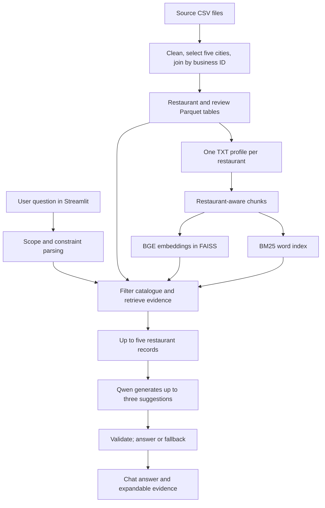

# Architecture and data flow

DineWise runs locally as a Streamlit interface, Python library, saved tables, two search indexes, and a Qwen model. It has no separate application server or database service. Preparing data is an offline operation; answering a query reads the saved artifacts.

## Offline preparation

The source files include businesses, reviews, review summaries, photo descriptions, and photo metadata. `make prep` selects food-service businesses in Philadelphia, Indianapolis, Tampa, New Orleans, and Tucson. It joins data by `business_id` and writes `restaurants.parquet` and `reviews.parquet`. The catalogue is the source for exact filters such as city and price; the review text supplies supporting evidence.

`make docs` writes marked TXT profile blocks. `make chunks` divides each block into overlapping token windows without crossing restaurant boundaries. `make index` encodes the chunks with BGE and saves a FAISS vector index; `make bm25` builds a word index over the same chunk IDs. `make rebuild` runs these steps for all four chunk configurations. C4 is currently active and has 12,697 chunks. The encoder reads at most 512 tokens even when the configured chunk target is larger.

## Runtime request

On startup, Streamlit loads the catalogue, active chunk table, BGE retriever, and BM25 index once per server process. Qwen loads lazily on the first supported recommendation. For each question, the workflow rejects unsupported live requests, extracts constraints with rules, filters eligible restaurants, searches both indexes, fuses the rankings, then generates and checks a response. The indexes and model remain cached for later questions.

The displayed chat history lives in Streamlit session state. Earlier messages are not inputs to retrieval or generation for a new question. The prompt asks for names instead of IDs in the main answer; the UI also strips any leaked IDs, while expandable evidence retains them. Price and rating summaries come from the retrieved catalogue metadata rather than from the generated prose.

## Research paths

The app uses base Qwen with hybrid RAG. Separate scripts compare BM25, dense, and hybrid retrieval; C1–C4 chunking; base and LoRA models with and without retrieval; and quantized model variants. The trained adapter does not run in the app. Results from different corpora or labels must be read separately.

Follow [the data engineering guide](05-data-engineering.md) for table construction, [retrieval](09-retrieval.md) for ranking, and [the workflow](11-workflow.md) for one question's control flow.
