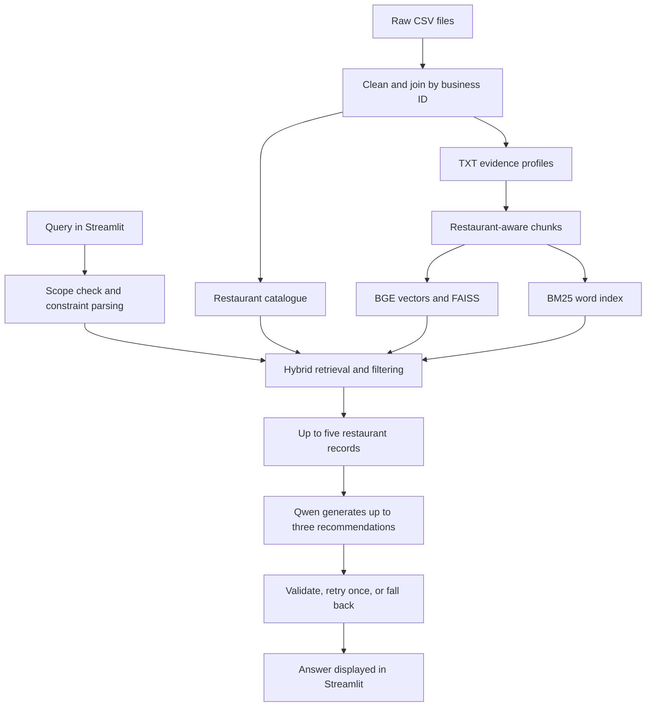

# Architecture

The app runs a plain Python workflow:

1. Check scope and parse cuisine, city, budget, and attribute constraints.
2. Retrieve restaurant evidence using BM25 and BGE/FAISS, fuse rankings with RRF,
   and keep restaurants that satisfy the constraints.
3. Generate a grounded answer using Qwen.
4. Validate the answer, retry generation once with the same constraints, then
   return a clear fallback if validation still fails.

The default corpus covers Philadelphia, Indianapolis, Tampa, New Orleans, and
Tucson without a pilot cap. The UI reads city coverage from the processed data.

Research scripts compare BM25/dense/hybrid retrieval, four chunking settings,
base and LoRA models with and without RAG, and quantization options. Training
and benchmark dependencies are optional; they are separate from the app flow.

## Data and request flow

Building indexes is an offline operation. A query reads existing artifacts; it does
not reprocess CSV files or train a model. The app caches resources within the server
process. A plain dictionary carries the query, parsed constraints, hits, generated
answer and validation diagnostics between workflow steps.

There is no separate API server or database service. FAISS and BM25 indexes are local
files. The current app uses base Qwen, while the LoRA adapter is used by research scripts.
